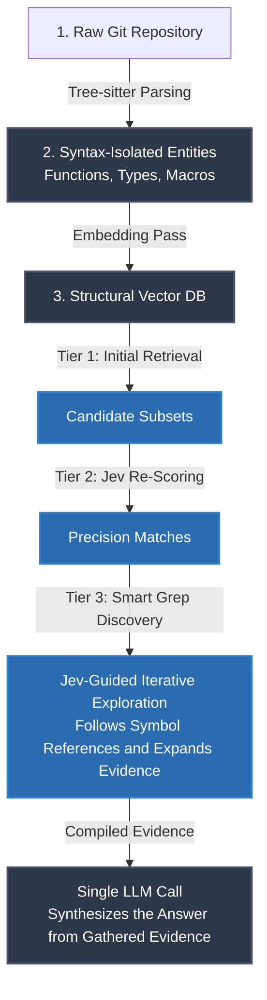

# unified-brain

**Persistent memory for System One coding agents, by [DevLoops](https://devloops.ai).**

On 24/10/2026 I have published as OSS a framework I call unified-brain that allows fast, cheap and accurate (same class of frontier models and frontier harnesses but 18 times cheaper) evidence gathering, using the cheapest frontier AI model out there, Jev. The results have been phenomenal.

The magic sauce is an intermediary OS (SQLITE) memory layer that facilitates retrieval, filtering and reasoning through a System One model, namely Jev.

The agent spawned from unified-brain runs through MCP on Cursor, OpenCode or Claude Code etc. allowing you to use it through your favorite harness.

> So to be clear here: unified-brain is not a harness but a perception layer any harness plugs in!

My test benchmarks have been so good on two large OS libraries (found in benchmarks on this repo) that I really believe this is the missing link to make AI more reliable.

This is because the limits holding back AI are:

- **The Reasoning and Hallucination Gap**:

The LLM turn reasoning it is introducing uncertainty and probabilistic outcomes.

BUT.. Unified-brain's System One discovery engine is producing replicable results across runs as they introduce minimal hallucinations, breaking the task in hundreds of yes or no calls.

- **Context Loss and Memory Limits**:

Long-running coding tasks consume massive amounts of tokens, causing the agent to forget early instructions or lose track of large-scale architecture.

BUT.. Unified-brain doesn't need cached memory thanks to the SQLITE persistent layer of context it operates with. It simply retrieves what it needs on the fly consuming minimal amounts of tokens that do not build up across questions. Every question is independent from one another as git diffs and commits will automatically be absorbed from the project's memory layer (still working on that last part).

---

Perhaps the most exciting development however from this proposed shift (established turn based exploration to System One evidence gathering) might be that avoiding unnecessary autoregressive investigation can reduce repeated weight and attention-state memory traffic. By using persistent retrieval and non-autoregressive judgments for discovery, unified-brain has a credible mechanism for reducing energy per correctly answered question — even when the conventional agent uses prompt caching.

**Several architectural factors support this optimism:**

- **Fewer intermediate decoding steps—even with caching.** In a conventional full-attention agent, each generated reasoning or tool-selection token attends to the accumulated context through its KV cache. Caching avoids recomputing earlier token states, but does not eliminate the attention work and memory access needed for subsequent generation. By replacing many intermediate generated tokens with bounded non-autoregressive judgments, unified-brain can avoid those repeated accesses during discovery.

- **Reduced KV-cache pressure.** Keeping investigation state outside the generative model can reduce the intermediate tokens whose attention states must be stored, accessed, or recomputed.

- **Less attention over exploration history.** The writer can receive selected evidence without repeatedly attending to unsuccessful searches, redundant tool results, and earlier investigative discussion.

- **Less repeated prefill work when caching misses.** Separating discovery from synthesis reduces opportunities for growing or changing prompts to trigger redundant computation.

- **Reusable repository preparation.** Persistent symbol and history indexes spread the cost of parsing and organizing evidence across many questions.

- **Efficient execution of independent judgments.** Non-autoregressive decisions can be batched or run concurrently, creating opportunities for better hardware utilization without generating intermediate prose.

- **Reduced demand for frontier-model execution.** Reserving the generative model primarily for synthesis can reduce its total inference workload, potentially lowering the serving capacity needed for a fixed volume of tasks.

- **Potentially greater serving capacity.** Reducing generative investigation could allow existing infrastructure to serve more correctly answered questions per minute by freeing model execution time and KV-cache capacity. The gain depends on the serving bottleneck and the resources required by Jev, retrieval, and final synthesis.

- **Potentially fewer corrective attempts.** If structured discovery improves evidence completeness and accuracy, it can reduce costly follow-up investigation and answer regeneration.

---

I invite you to fork the project and have a look for yourself! I firmly believe that memory intermediate structures combined with System One models will take AI capabilities to the next level soon.

The philosophy behind this venture is to address contemporary inference issues in SWE through architectural elegance, rather than relying primarily on brute force scaling.



I understand that Jev is proprietary and creates a dependency BUT as time passes by, I expect open-source models to narrow the gap over time, giving OS end users additional options. At the moment however, I must say, I have come to the conclusion after my limited experiments, that there is no parity.

Right now, I believe we should ride this wave of innovation in order to deliver new capabilities to end users, at prices and replicable accuracy that can't be easily beaten.

## How it works

unified-brain reads a repository's whole git history and stores every version of
every symbol — functions, types, macros, config entries — with the commit that
introduced it, using tree-sitter, in one SQLite
db inside the repository in question (`<repo>/.unified-brain.db`). On top of that it
answers two questions, as of any commit:

- **Ask** — "why does X do Y?", answered from the bodies that were live at the
  commits you pick, found by embeddings → Jev (a small judge model that scores
  and follows names through the code) → one write by the LLM of your choice.
- **Timeline / reports** — pick a range of commits and have every changed symbol
  judged: does the change do what the commit message says, or is there a defect
  or a malicious intent behind it? Each verdict comes with the evidence the
  judge was shown (diffs, same-commit changes, callers, the chains Jev followed).

No LLM is used during ingestion. One embedding pass runs at the end.

## Requirements

- Python 3.11 or newer (SQLite comes with it; nothing else to install or run).
  The tree-sitter grammars (about 16 MB) are fetched from github.com on the
  first parse and cached under `~/.cache/tree-sitter-language-pack`;
  `python ingester.py <repo> prefetch` fetches them up front (behind a proxy,
  or before going offline).
- API keys: Jev, directly from [Typesafe](https://typesafe.ai) or through
  [OpenRouter](https://openrouter.ai); one writer provider ([Fireworks](https://fireworks.ai)
  for DeepSeek, or Anthropic); and, optionally, one embedding provider —
  [Voyage AI](https://www.voyageai.com) or [DeepInfra](https://deepinfra.com)
  (Qwen3-Embedding-8B, cheaper). Without one, set `CODE_EMBED_PASS2=none` and
  `QA_VECTOR_STORE=none`: the ingest skips the embedding pass and Jev scores
  every symbol of the repository for each question instead of the nearest 400.

## Quick start

Everything below runs in a terminal, from the `unified-brain` folder, with the
virtual environment active. The examples use a clone of
[xz](https://github.com/tukaani-project/xz) at `~/code/xz`; use your own path.

### 1. Install

```bash
git clone https://github.com/DevLoops-ai/unified-brain.git
cd unified-brain
python3 -m venv .venv && source .venv/bin/activate
pip install -r requirements.txt
cp env.example .env
```

Open `.env` and fill in Part 1. The minimum (comments go on their own lines
or after a value and a space, never after an empty value — python-dotenv
reads `KEY=   # text` as the value `# text`):

```
# the database the service answers about (written by step 2)
DB_PATH=/Users/you/code/xz/.unified-brain.db
# writer: llmbase = DeepSeek V4.1 Flash on Fireworks, or anthropic
LLM_PROVIDER=llmbase
LLM_API_KEY=...
# Jev: directly at Typesafe, or JEV_PROVIDER=openrouter with OPENROUTER_API_KEY
JEV_PROVIDER=typesafe
TYPESAFE_API_KEY=...
# code embeddings: qwen (the benchmarks), voyage (then VOYAGE_API_KEY instead),
# or none (no key; Jev scores every symbol)
CODE_EMBED_PASS2=qwen
QA_VECTOR_STORE=qwen
DEEPINFRA_API_KEY=...
```

### 2. See what will be indexed

Before ingesting, a few seconds show which files the ingester covers symbol
by symbol, which it stores whole, and which it skips (binary files are not
stored). 

```bash
python ingester.py ~/code/xz scan-coverage
```


### 3. Ingest a repository

The ingester reads the git history and writes one file,
`<repo>/.unified-brain.db`. No LLM is used; it is CPU work plus git. When the
commits are in, the embedding pass runs once over the stored bodies.

A first try — a slice of the history, so you see results in minutes:

```bash
# 1,349 commits of xz, from January 2021 (the threaded decoder work) to July 2024
python next_claude.py ~/code/xz \
  --since f7fa309e1f7178d04c7bedc03b73077639371e97 \
  --max 1349
```

`--since <ref>` starts after a commit or tag; `--max N` stops after N commits.
Progress prints one line per commit and a summary at the end
(`✅ 1349 commit(s) ingested … skills created=… updated=… obsoleted=…`),
then the embedding pass (`🧬 embedding pass [voyage] … 1943/1943`).

The whole history of a repository:

```bash
python next_claude.py ~/code/xz
```

On a laptop this takes a while (open62541: 13,474 commits in 96 minutes on an
M3, then 56 minutes of embedding). On macOS keep the machine awake with
`caffeinate`, in the same terminal:

```bash
caffeinate -i python next_claude.py ~/code/open62541
```

Stopped half-way (Ctrl+C, sleep, crash)? Continue from the last ingested commit:

```bash
python next_claude.py ~/code/xz --resume
```

Run it once after upgrading unified-brain, too: a database written by an
older version gets its symbol index brought up to date first (qualified
names such as `Counter.inc` are now listed under `inc` as well).

To start over, delete the `.unified-brain.db` file.

The command exits 1 when a commit or an embedding batch failed, or when
`CODE_EMBED_PASS2` names a store whose key is missing (no vectors were
written); with no embedding key, set `CODE_EMBED_PASS2=none`.

### 4. Embeddings (only if you need to redo them)

The ingest already runs the embedding pass for the provider in
`CODE_EMBED_PASS2`. Two cases need the separate commands:

```bash
# the ingest finished but the embedding pass did not (key missing, network):
python next_claude.py ~/code/xz --embed-only

# add or redo one provider's vectors on an existing database:
python reembed_code_vectors.py --provider voyage --db ~/code/xz/.unified-brain.db
python reembed_code_vectors.py --provider qwen   --db ~/code/xz/.unified-brain.db
```

Both providers can live in the same database; `QA_VECTOR_STORE` picks the one
questions use. Cost to expect: open62541's 277,080 body versions cost about
$1.30 with Qwen on DeepInfra. Add `--dry-run` to count without embedding.


### 5. Start the service

`DB_PATH` in `.env` must point at the database you want to ask about — one
service, one repository. Then:

```bash
python codebase_qa_service.py
```

Open http://127.0.0.1:8000 to ask questions and http://127.0.0.1:8000/timeline
for the commit timeline and reports. The server listens on localhost only.
Each answer ends with a line of numbers: time per phase, Jev cost, writer speed.
Ctrl+C stops it.

To switch repositories, stop the service, change `DB_PATH`, start it again.

### 6. Give it to your coding agent (Cursor, Claude Code, any MCP client)

`unified_brain_mcp.py` is an MCP server with two tools. `retrieve`: the agent
hands over the question, gets back the evidence — every body that answers it,
with file, symbol and line — and writes the answer from it. It talks to the
running service, so step 5 must be running; when the service is stopped the
agent works without it and says so.

Cursor — `.cursor/mcp.json` in the project you are working on (Cursor settings
→ Customize → MCP shows it; use Agent mode):

```json
{"mcpServers": {"unified-brain": {
  "command": "/path/to/unified-brain/.venv/bin/python",
  "args": ["/path/to/unified-brain/unified_brain_mcp.py"],
  "env": {"UNIFIED_BRAIN_URL": "http://127.0.0.1:8000"}}}}
```

Claude Code — the same object in `.mcp.json`. The tool takes 20–60 seconds
(Jev is reading); ask the agent to use unified-brain for the question.

The service also answers plain HTTP for scripts: `POST /api/retrieve`,
`GET /api/grep`, `/api/symbol/{name}`, `/api/body`, `/api/history`,
`/api/commit/{hash}`.

### 7. Ask for conclusions, not only evidence (claims)

`retrieve` hands the agent code to read. `evaluate_claims` goes one step
further: the agent states claims about the code in plain language, Jev reads
every retrieved body once per claim and says whether it supports it,
contradicts it or is silent, and each claim comes back as **true**, **false**,
**conflicted** or **unknown**, with the file, symbol and line of the passages
it rests on. Rules combine claims into conclusions. The semantics are a Python
port of [Factbag](https://github.com/factbag/factbag) (Apache-2.0; see
`NOTICE`): evidence keeps its source, a claim with evidence both ways is
*conflicted* rather than averaged, a claim nothing spoke to is *unknown*, and a
`closed` claim with no evidence is *false*.

```bash
curl -s http://127.0.0.1:8000/api/claims/evaluate -H 'content-type: application/json' -d '{
  "question": "How does the verifier decide the near-equal-radius cylinder verdict?",
  "claims": [
    {"name": "uses_tolerance", "description": "The comparison uses an explicit numeric tolerance rather than exact equality."},
    {"name": "logs_verdict",   "description": "The verdict is written to a log or report."}
  ],
  "rules": [{"head": "auditable", "iff": {"and": ["uses_tolerance", "logs_verdict"]}}]
}'
```

The reply holds `judgments` (one per claim and rule head: `value`, `because`,
`sources`, and the proof tree under `explanation`), the `passages` read, the
Jev `cost_usd`, and an `id`. `GET /api/claims/{id}` returns it again;
`POST /api/claims/{id}/retract` with `{"literal_ids": [...]}` removes evidence
by hand (the ids are in the proof tree) and queries again without a Jev call;
`POST /api/claims/{id}/resolve` asks Jev to settle conflicted claims by reading
the disagreeing passages together and retracting the superseded ones.
`GET /api/claims` lists past evaluations. Evidence comes from the question's
retrieval, or from explicit `skill_ids`. A claim may carry `params`
(`{"year": [2024, 2025]}`), which makes one candidate per value; a formula is
a claim name, `{"not": f}`, `{"and": [..]}`, `{"or": [..]}` or
`{"atom": {"predicate": name, "fields": {...}}}`. The thresholds are Factbag's
(a polarity needs probability 0.4 and must beat "irrelevant"); Part 2 of
`env.example` has the knobs. Cost: one Jev call per passage and claim.

A claim with `"scope": "symbol"` is asked of every retrieved symbol
separately, each from its own body ("which of these functions validate
input"), and comes back as a `by_symbol` table with a `summary`; the MCP tool
does the same with `per_symbol=true`. Rules then take variables:

```json
{"head": {"predicate": "safe", "fields": {"symbol": {"var": "S"}}},
 "iff": {"and": [{"atom": {"predicate": "validates_input", "fields": {"symbol": {"var": "S"}}}},
                 {"not": {"atom": {"predicate": "logs_secret", "fields": {"symbol": {"var": "S"}}}}}]}}
```

A new rule head takes the types of its variables from the body.

The timeline report uses the same layer: every probe also has Jev answer
four fixed claims about the change (achieves the stated goal, introduces a
defect, is suspicious, is dormant) from the texts the judge reads, shown as
badges next to the verdict with their sources in the Evidence panel. When a
defect claim is true and harsher than the verdict it is filed as a finding
by `claims:<probe>`, so the probe is contested and rerun once with it as a
lead; a severe verdict that both defect claims deny is marked "claims
milder". `PROBE_CLAIMS=0` skips the pass, `PROBE_CLAIMS_FINDINGS=0` keeps
the badges without the findings.

### What a question costs

Measured with the configuration in Part 1 of `env.example`:

- open62541 (300k lines of C, sparse comments), hard tracing questions:
  Jev $0.07–0.09 in 15s, plus the writer: $0.01 on DeepSeek V4.1
  Flash (85–110k tokens in, 6–11k out), most of it spent thinking before
  the first word — 60–120 s per answer in total depending on provider speed/traffic.
- xz (heavily commented): about the same per question, but the fixed
  scoring step costs more ($0.036 vs $0.014 for the same 400 calls) because
  xz's bodies carry many more tokens each.
- Vague questions ("what is this library for?") are cheaper on Jev.
- One comparison so far, same question, same Cursor model, caches cold:
  Cursor exploring on its own used 9% of a $20 plan; with unified-brain
  2% plus $0.12 of Jev. `benchmarks/` holds the pre-registered protocol and
  the grading sheet of the comparison set; the results are pending.
- openscad-rsi (Rust, Python and OpenSCAD; 2,351 symbols) with no embedding
  pre-filter, Jev direct through Typesafe: $0.13–0.19 of Jev and 34–51 s per
  question, 0 failed calls, the deciding code in the evidence for all three
  questions asked (11 of the 12 hand-located definitions; one parallel test
  change missed on question 2) — the full numbers are in
  `benchmarks/openscad-rsi.md`.

Each answer ends with a line of these numbers for your own run. Part 2 of
`env.example` lists the constants that move them; the ones we tested are
noted there.

### Tests

```bash
pip install pytest && pytest -q
```

The tests build a three-commit repository in a temporary folder, ingest it
and start the service with Jev mocked; no key is needed, and no network once
the tree-sitter grammars are cached (the first run fetches them from
github.com, see Requirements). CI runs them on Python 3.11 and 3.13 on every
push and pull request.

## How it is built

| File | Role |
|---|---|
| `next_claude.py` | the `ingest` command: git history → the database file, then the embedding pass |
| `ingester.py` | reads commits and extracts symbols with tree-sitter (C, C++, Python, TypeScript, JavaScript, Rust, OpenSCAD, shell, CMake, YAML; assembly by regex; make, m4 and automake stored whole-file) |
| `defkey_reconciler.py` | keeps the symbol index right as lines move, symbols change or disappear |
| `store.py` | the database: one SQLite file, with the text index for grep and the vector tables |
| `skills_lib.py` | the record layer: skills, bodies per commit, edges, code vectors, grep |
| `reembed_code_vectors.py` | the embedding pass (one set of vectors per stored body version) |
| `jev_client.py` | the one Jev call helper: provider table (Typesafe or OpenRouter), retries, cost |
| `factbag_core.py` | claims: facts, rules and four-valued conclusions with provenance (a port of Factbag's core) |
| `factbag_jev.py` | claims: Jev reads passages and assesses claims; passages, guard, classifier, resolver |
| `codebase_qa_service.py` | the FastAPI service: questions, timeline, reports, evidence, claims |
| `templates.py` | the two pages |
| `unified_brain_mcp.py` | the MCP server for coding agents: `retrieve` and `evaluate_claims` (thin clients of the service) |

## Known limitations

- The service has no authentication and answers any origin (CORS `*`). It
  listens on localhost only; do not expose the port — every question costs
  money.
- `store.py` is a Redis-like API over one SQLite file. Its lease and counter
  operations (`set nx`, `incr`, `hincrbyfloat`) are read-then-write, not
  atomic, and the service and the ingester should not write the same database
  file at the same time: stop the service before ingesting into its database.
- The pages insert model output into the HTML unsanitized (the answer through
  `marked.parse`; the timeline inserts several fields unescaped). Fine on your
  own machine; one more reason not to expose the port.
- `requirements.txt` pins some packages exactly and others with a lower
  bound; there is no lockfile. The tree-sitter grammars are not bundled with
  `tree-sitter-language-pack`: they are downloaded from github.com on first
  use (or by `python ingester.py <repo> prefetch`) and cached under
  `~/.cache/tree-sitter-language-pack`. Without that cache and without
  network, every `.py`, `.rs`, `.c`… file is stored whole instead of symbol
  by symbol; the ingest logs `NO_GRAMMAR` once per language on stderr.

## Licence

AGPL-3.0, with a commercial licence available — see `LICENSING.md`.
Contributions need the CLA in `CLA.md`.

Copyright (c) 2026 DevLoops SINGLE MEMBER P.C.